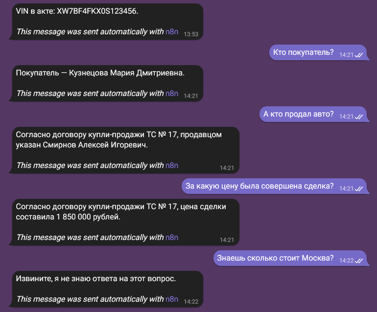

# docbot — RAG-ассистент по документам с Telegram-интерфейсом

  

## Что делает

Отвечает на вопросы по договору купли-продажи автомобиля: ищет релевантные куски
документа в FAISS и отвечает только по ним. Если ответа в документе нет — честно
говорит «Извините, я не знаю ответа на этот вопрос.», вместо того чтобы предоставлять ложные данные пользователю.
Спросить можно прямо в Telegram(демо): бот слушает чат и отвечает сам, без терминала.

  

## Для чего создавался

Данный пет-проект задумывался как сервис, который заполняет шаблон договора по входным данным.
Начал со сложной половины — научить машину понимать готовые документы:
поиск по корпусу, ответы только по тексту, честный отказ вне документов.
Следующие шаги - подключить tool calling, собрать целевую архитектуру 
(единая точка входа, рендер шаблона) для полноценной реализации задуманного,
провести тесты и оценить качество на других моделях с большим количеством данных
в "боевых условиях"

## Архитектура

Telegram → n8n (Telegram Trigger) → FastAPI `/answer` → RAG → ответ в Telegram.

Два доказанных пути в `workflows/`: входящий триггерный и outbound webhook.

  

## Стек

Python · uv · LangChain + FAISS · FastAPI · n8n · Docker · DeepSeek (OpenAI-совместимый API) · pydantic-settings

  

## Запуск

| Процесс | Где живёт | Команда | Порт | Проверка |
|---|---|---|---|---|
| n8n + postgres + redis | контейнеры | `docker compose up -d` | 5678 | `docker compose ps`, браузер :5678 |
| FastAPI-сервис | терминал | `uv run uvicorn app:app --reload --host 0.0.0.0 --port 8000` | 8000 | `/docs`, лог `POST /answer 200` |
| Eval | терминал | `uv run eval.py` | — | `4/4`, `1/1`, `[eval] model=...` |
| Туннель (входящий TG) | терминал | `ssh -p 443 -R0:localhost:5678 a.pinggy.io` | публичный https | лог pinggy `POST 200` |
| LangFlow (опционально) | контейнер | `docker run -p 7860:7860 langflowai/langflow` | 7860 | браузер :7860 |
  

Порядок: docker → uvicorn. Для входящего демо: `WEBHOOK_URL=<туннель>` в `.env` →

`docker compose up -d` → Publish workflow `telegram_trigger`. Ключ API — в `.env`

(шаблон в `.env.example`); `Settings` читает только свои ключи (`extra="ignore"`).

  

## Eval (golden set, n=5, temperature=0)

| Модель | accuracy | refusal_accuracy |
|---|---|---|
| deepseek-chat | 4/4 | 1/1 |
| deepseek-reasoner | 4/4 | 1/1 |

На MVP-наборе модели неразличимы; для разведения — расширить `golden_set.json`

(данные отдельно от кода). Имя модели печатается в прогоне: сравнение наблюдаемо.

Отказ проверяется строго (маркер отказа), чтобы «вежливая галлюцинация» не прошла.

  

## Демо

Четыре живых вопроса в чате: покупатель, продавец, цена — и честный отказ на

вопрос вне документа. Следы пути: pinggy `POST 200` ×4 и uvicorn `POST /answer 200` ×4.

  

## Структура

workflows/  — графы n8n как код (webhook_outbound.json, telegram_trigger.json)

assets/     — скриншоты демо и исходник договора

docs/       — корпус документов для индекса

index_faiss/— закоммичен специально: клон → сразу eval, без шага build

src/        — scaffold-задел под packaging, сейчас не используется

*.py        — модули приложения в корне

  
